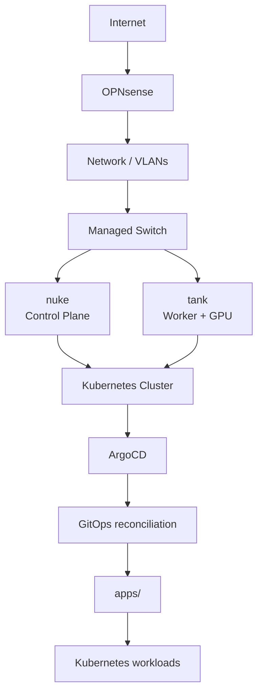
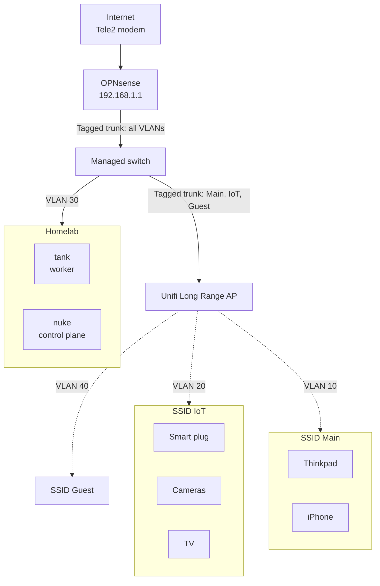
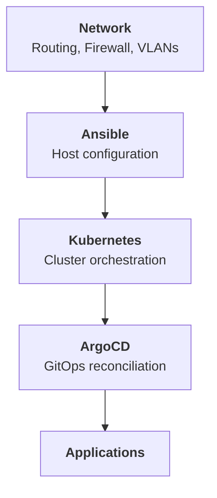

# HomeOps

Infrastructure-as-Code and GitOps configuration for my self-hosted Kubernetes homelab.

This repository is the source of truth for the infrastructure and workloads running in the cluster. It combines host configuration with Ansible and Kubernetes configuration with GitOps through ArgoCD.

The goal is to keep the environment **reproducible, declarative and version-controlled**, while using the homelab as a practical environment for learning and applying DevOps, Kubernetes, Linux, networking and infrastructure automation.

## Architecture



The infrastructure is intentionally separated into distinct layers:

| Layer                  | Responsibility                                   |
| ---------------------- | ------------------------------------------------ |
| **OPNsense / Network** | Routing, firewalling and network segmentation    |
| **Ansible**            | Bare-metal host configuration                    |
| **kubeadm**            | Kubernetes cluster bootstrap and node membership |
| **Kubernetes**         | Container orchestration                          |
| **ArgoCD**             | GitOps reconciliation                            |
| **apps/**              | Declarative Kubernetes workloads                 |
| **GitHub**             | Version control and source of truth              |

## Nodes

The current cluster consists of two Kubernetes nodes:

| Node   | Role                                                    |
| ------ | ------------------------------------------------------- |
| `nuke` | Kubernetes control plane                                |
| `tank` | Kubernetes worker with GPU and storage responsibilities |

Node-specific host configuration is managed through Ansible.

See [`ansible/`](./ansible/) for the configuration and recovery workflow.

## GitOps

ArgoCD continuously reconciles the Kubernetes configuration stored in this repository.

Changes to Kubernetes workloads are therefore made through Git rather than manually modifying resources inside the cluster.

The desired state lives in:

```text
apps/
```

ArgoCD is responsible for bringing the running cluster back toward that desired state.

See [`apps/`](./apps/) for the Kubernetes configuration.

## Host Configuration

Ansible manages configuration below the Kubernetes layer.

It is responsible for making the underlying hosts ready to participate in the cluster, including:

* Common host packages
* Kubernetes node prerequisites
* Swap configuration
* CNI configuration
* NVIDIA GPU configuration

Ansible intentionally stops at the host boundary. Kubernetes workloads remain under GitOps control through ArgoCD.

See [`ansible/`](./ansible/) for details.

## Networking

The homelab network is managed separately from the Kubernetes workloads.

OPNsense provides routing, firewalling and network segmentation, with VLANs being used to establish boundaries between different classes of devices and services.

The network is laid out as follows. VLAN 30 carries the homelab, and the access point trunks the Main, IoT and Guest VLANs.



Network segmentation is an ongoing part of the homelab and is being developed alongside the Kubernetes infrastructure.

## Automation

The repository also uses GitHub-based automation for maintaining and validating the configuration.

Current automation includes:

* GitHub Actions
* Renovate
* Ansible automation
* ArgoCD GitOps reconciliation

The intention is to reduce manual configuration and make infrastructure changes auditable through Git history.

## Repository Structure

```text
.
├── .github/
│   └── workflows/       # CI and repository automation
│
├── ansible/             # Bare-metal host configuration
│
├── apps/                # Kubernetes workloads and GitOps configuration
│
├── argocd/              # ArgoCD Application definitions (app-of-apps)
│
├── docs/                # Documentation (backup and recovery)
│
├── renovate.json        # Automated dependency updates
│
└── README.md            # Project overview
```

## Design Principles

### Declarative configuration

Infrastructure and workloads should be described as desired state rather than relying on undocumented manual changes.

### Git as the source of truth

Configuration changes are made through Git and can be reviewed, reverted and audited through the repository history.

### Separation of responsibilities

Each layer has a defined responsibility:



### Reproducibility

The configuration should contain enough information to rebuild the environment without depending on undocumented manual steps.

This does not replace data backups. Application data and infrastructure configuration are separate concerns.

## Documentation

* [`ansible/`](./ansible/) — host configuration and node recovery
* [`apps/`](./apps/) — Kubernetes workloads and GitOps configuration
* [`argocd/`](./argocd/) — ArgoCD Application definitions and rebuild steps
* [`docs/backup.md`](./docs/backup.md) — Sealed Secrets key backup and recovery

## Status

**Active development**

This is a continuously evolving homelab. Infrastructure, networking, automation and workloads are added and refined as the environment grows.

## Purpose

This project is primarily a learning and experimentation environment for:

* Kubernetes
* GitOps
* Infrastructure as Code
* Ansible
* Linux administration
* Networking and network segmentation
* Containerization
* Cloud-native technologies
* Infrastructure automation
* Self-hosted services
