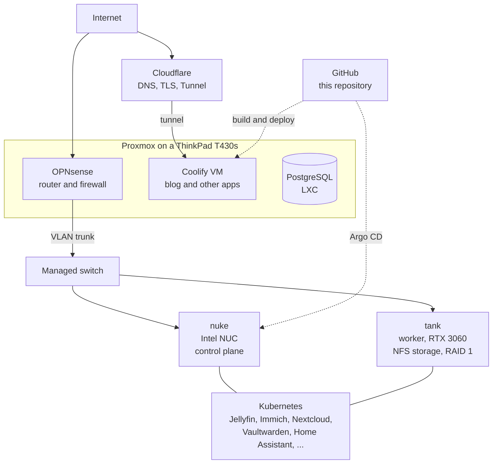
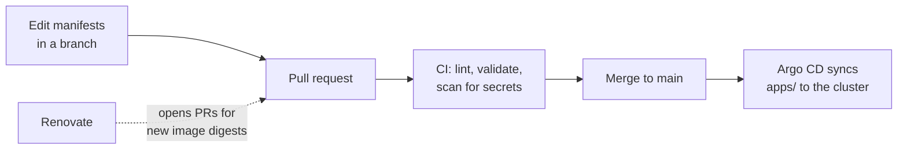
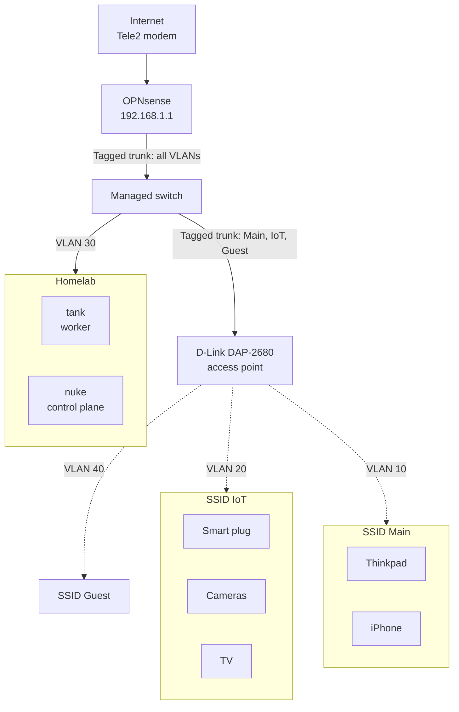

# homelab

[](https://github.com/Megjafari/homelab/actions/workflows/validate.yml)
[](https://github.com/Megjafari/homelab/actions/workflows/blog-ci.yml)

A self-hosted Kubernetes homelab, described as code and operated through Git. This repository is the source of truth for the hosts, the cluster workloads, the CI around them and the blog that documents it: [blog.meghdadjafari.dev](https://blog.meghdadjafari.dev).

I built it to learn what happens to an application after the code is written: where it runs, how it is reached, how the machines under it are managed, and what breaks. Everything here is what is actually running.

## What runs where



| Machine | Role |
| --- | --- |
| ThinkPad T430s | Proxmox host: OPNsense, Coolify and a PostgreSQL container |
| Intel NUC `nuke` | Kubernetes control plane |
| Self-built server `tank` | Kubernetes worker with a GPU, and the NFS storage (two disks in RAID 1) |

## What this demonstrates

| Skill | Where to look |
| --- | --- |
| **GitOps** with Argo CD, app-of-apps, one Application per namespace | [`argocd/`](./argocd/), [`apps/`](./apps/) |
| **Kubernetes** on bare metal with `kubeadm`, NFS-backed storage, GPU scheduling | [`apps/`](./apps/), [`docs/cluster-components.md`](./docs/cluster-components.md) |
| **Configuration management** with Ansible, linted in CI | [`ansible/`](./ansible/) |
| **Secrets handling**: Sealed Secrets in Git, key backup and recovery, secret scanning in CI | [`docs/backup.md`](./docs/backup.md), [`.gitleaks.toml`](./.gitleaks.toml) |
| **CI**: YAML lint, schema validation, kube-linter, Ansible lint, gitleaks | [`.github/workflows/validate.yml`](./.github/workflows/validate.yml) |
| **Dependency hygiene**: images pinned by digest, Renovate on a weekly schedule | [`renovate.json`](./renovate.json) |
| **Networking**: VLAN segmentation with OPNsense, Tailscale for private access, Cloudflare Tunnel for public services | [Networking](#networking) |
| **Posts as code**: Markdown in Git, built into a static site and deployed | [`content/`](./content/), [`blog/`](./blog/) |

## How a change reaches the cluster



Workloads are changed through Git, not with `kubectl`. Argo CD applies `apps/<namespace>/` into the namespace of the same name. Automated sync is on, with `prune` and `selfHeal` off for now, so the cluster is never changed by something that is not in Git, and nothing is deleted without a conscious step.

## Layers

| Layer | Responsibility | Lives in |
| --- | --- | --- |
| Network | Routing, firewall, VLANs | OPNsense, D-Link AP |
| Hosts | Packages, swap, CNI, NVIDIA driver | [`ansible/`](./ansible/) |
| Cluster | Bootstrap and membership | `kubeadm`, [`docs/cluster-components.md`](./docs/cluster-components.md) |
| Workloads | Everything that runs in Kubernetes | [`apps/`](./apps/), [`argocd/`](./argocd/) |
| Content | The blog and its posts | [`blog/`](./blog/), [`content/`](./content/) |

Ansible stops at the host boundary; Argo CD owns everything inside the cluster.

## Networking

OPNsense provides routing, firewalling and segmentation. VLAN 30 carries the homelab, and the access point trunks the Main, IoT and Guest VLANs.



The blog is published through a Cloudflare Tunnel, so no router ports are forwarded for it. Everything else is reached over Tailscale.

## What it runs

Jellyfin (with GPU transcoding), Immich, Nextcloud, Vaultwarden, Home Assistant, Navidrome, the Sonarr/Radarr/Prowlarr stack with qBittorrent behind a VPN sidecar, Prometheus, Grafana, Uptime Kuma and a Homepage dashboard.

## Lessons from running it

These are real problems, now fixed in the manifests:

- **A rolling update can deadlock on a single GPU.** Jellyfin requests the node's only GPU, so the new pod stayed `Pending` for hours while the old pod held it. Fix: `strategy: Recreate`.
- **Databases lock their data directory.** During a rolling update the new Mongo and Prometheus pods crash-looped on the lock held by the old pod, so the rollout never finished. Fix: `Recreate` on every single-replica app with a PVC.
- **`:latest` makes Git history meaningless.** Every image is now pinned by digest, which makes rollbacks real and gives Renovate something to update.
- **A secret scanner must understand sealed secrets.** Gitleaks flagged the encrypted values in `sealed-secret.yaml`; they are ciphertext, so those files are allow-listed explicitly rather than turning the check off.

More detail goes into the [blog](https://blog.meghdadjafari.dev).

## Known gaps

Stated plainly, because a portfolio should not pretend:

- Only the Sealed Secrets key has a backup procedure. Application data on NFS has no off-host backup yet.
- No NetworkPolicies (the CNI is Flannel), so pods can reach each other freely.
- Most workloads still run with their image's default user (often root); only Grafana and Prometheus have a hardened `securityContext`.
- Services are exposed as `NodePort`; there is no ingress controller yet.
- `kube-linter` runs as an advisory check, because the findings above are not fixed yet.
- Argo CD `prune` and `selfHeal` are off.
- Terraform for Proxmox, Cloudflare and GitHub is planned, not done.

## Repository layout

```text
.
├── .github/workflows/   # CI: validate.yml (manifests, Ansible, secrets), blog-ci.yml
├── ansible/             # Host configuration
├── apps/                # Kubernetes workloads, one directory per namespace
├── argocd/              # Argo CD Applications (app-of-apps)
├── blog/                # The blog frontend (React, Vite)
├── content/             # Blog posts as Markdown, built into the site
├── docs/                # Backup and cluster component documentation
├── scripts/             # Helper scripts
├── .gitleaks.toml       # Secret scanning rules
└── renovate.json        # Automated dependency updates
```

## Documentation

- [`ansible/`](./ansible/) – host configuration and node recovery
- [`apps/`](./apps/) – workloads, storage and operations
- [`argocd/`](./argocd/) – Applications and the rebuild order
- [`docs/backup.md`](./docs/backup.md) – Sealed Secrets key backup and restore
- [`docs/cluster-components.md`](./docs/cluster-components.md) – hand-installed components and versions
- [`blog/README.md`](./blog/README.md) – how a post is published

## Design principles

- **Declarative.** Describe the desired state; avoid undocumented manual changes.
- **Git as the source of truth.** Changes are reviewed, reverted and audited through history.
- **Separated responsibilities.** Each layer owns one thing.
- **Reproducible.** The repository should contain enough to rebuild the environment. Data backups are a separate concern.
