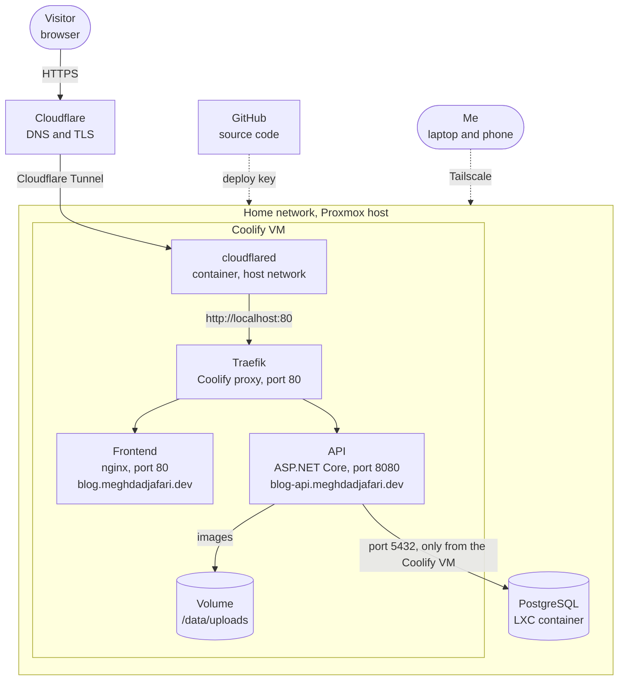

## Introduction

This blog is a small ASP.NET Core API, a React frontend and a PostgreSQL database. I run it in my homelab instead of on a hosting service, so I can see every part of the setup and write it down.

This post describes how it is deployed, and the four things that broke before it worked. I picked it as the first technical post because I just built the setup from scratch and still remember the details.

## Architecture



Everything runs on one Proxmox host. A Coolify VM runs the two apps. PostgreSQL lives in its own LXC container. I did not forward any ports on the router. A Cloudflare Tunnel connects the Coolify VM to Cloudflare, and Cloudflare serves the two public names:

- `blog.meghdadjafari.dev` for the frontend
- `blog-api.meghdadjafari.dev` for the API

A request takes this path: the visitor reaches Cloudflare over HTTPS, the tunnel carries it to a `cloudflared` container on the Coolify VM, and that container hands it to Coolify's proxy (Traefik) on `localhost:80`. Traefik picks the frontend or the API based on the host name.

The rest of my homelab is only reachable over Tailscale, so I manage Coolify and the database from my laptop through it.

## Building the two apps

Both apps have their own Dockerfile.

The **API** uses a multi-stage build: the .NET 10 SDK image builds it and the smaller ASP.NET runtime image runs it on port 8080. Database migrations run when the API starts. Uploaded images are stored on disk in `/data/uploads`, which is a Coolify volume. I chose that over running MinIO because it is one service fewer to look after.

The **frontend** is built with Node and served by nginx, with a fallback to `index.html` so that client-side routes work. Vite reads its settings at build time, so the API address is passed as a build argument (`VITE_API_BASE_URL`) and baked into the JavaScript.

In Coolify I entered the domains as `http://...`, not `https://...`. TLS ends at Cloudflare, and the server cannot be reached from the internet, so there is no point asking Coolify for a certificate.

## The database

PostgreSQL runs in an LXC container with Debian 13 and PostgreSQL 17. I created a user and a database called `blog`, and added one line to `pg_hba.conf` so that only the Coolify VM can connect:

```
host  blog  blog  <coolify-vm-ip>/32  scram-sha-256
```

The password goes into a connection string, so I used only letters and digits. Characters like `;` and `=` would break it.

## What broke

### 1. The API crashed on every start

**Symptom:** Coolify showed the app as `Exited (10x restarts)`. The Logs tab said `No containers are running`, so there was nothing to read.

**Investigation:** Coolify removes the container once it gives up. I redeployed, and while the container was still alive I ran this on the Coolify VM:

```bash
docker ps -a
docker logs --tail 50 <container-name>
```

**Cause:** The log ended with `password authentication failed for user "blog"`. I had typed the wrong password into the Coolify environment variable, so it did not match the one I had set in PostgreSQL.

**Fix:** I set a new password with only letters and digits in PostgreSQL and used the same one in Coolify.

### 2. The Coolify VM could not pull images

**Symptom:** `docker run` failed with `lookup registry-1.docker.io on [::1]:53: connection refused`.

**Investigation:** `ping 1.1.1.1` worked, so the network was fine. `/etc/resolv.conf` contained only comments from `dhcpcd` and no name server at all.

**Cause:** The VM had no DNS server. I do not know why the DHCP lease did not include one.

**Fix:** I put name servers in `/etc/resolv.conf.head`, which `dhcpcd` adds at the top of the file every time it writes it:

```bash
printf 'nameserver 1.1.1.1\nnameserver 1.0.0.1\n' | tee /etc/resolv.conf.head > /etc/resolv.conf
```

### 3. Cloudflare answered 502

**Symptom:** `https://blog-api.meghdadjafari.dev/health` returned a 502 page from Cloudflare, while the tunnel showed as healthy.

**Investigation:** On the Coolify VM I sent the request to Traefik myself, with the right host name:

```bash
curl -H 'Host: blog-api.meghdadjafari.dev' http://localhost/health
```

It returned `200`, so the app and Traefik were fine. Then I checked how the tunnel container was started:

```bash
docker inspect <cloudflared-container> --format '{{.HostConfig.NetworkMode}}'
```

It said `bridge`.

**Cause:** The container ran on Docker's default bridge network, so `localhost:80` pointed at the container itself and not at the VM. The command that Cloudflare shows in its dashboard does not include a network option.

**Fix:** I recreated the container with host networking:

```bash
docker run -d --name cloudflared-blog --restart unless-stopped \
  --network host cloudflare/cloudflared:latest \
  tunnel --no-autoupdate run --token <token>
```

### 4. A health check that could never pass

**Symptom:** None, because I found it before turning the check on.

**Cause:** Coolify runs its health check as a command inside the container, and that needs `curl` or `wget`. I checked the ASP.NET runtime image I use:

```bash
docker run --rm --entrypoint sh mcr.microsoft.com/dotnet/aspnet:10.0 \
  -c 'command -v curl || echo "curl: not found"; command -v wget || echo "wget: not found"'
```

It printed `curl: not found` and `wget: not found`, so neither tool exists. As far as I know, Coolify then treats the container as unhealthy and its proxy stops sending traffic to it.

**Current fix:** I left the check off. The API has a `/health` endpoint that I check from the outside. A better solution would be to install `curl` in the image, which I have not done yet.

## Current state

Both apps run on the Coolify VM and are reachable through the tunnel. Database migrations run on start, uploaded images survive a redeploy because they are on a volume, and HTTPS is handled by Cloudflare. I deploy by pressing Deploy in Coolify.

## What's next

These are plans, not done:

- Back up the PostgreSQL database and the uploads volume.
- Deploy automatically when I push to GitHub.
- Make the Coolify health check work by adding `curl` to the API image.
