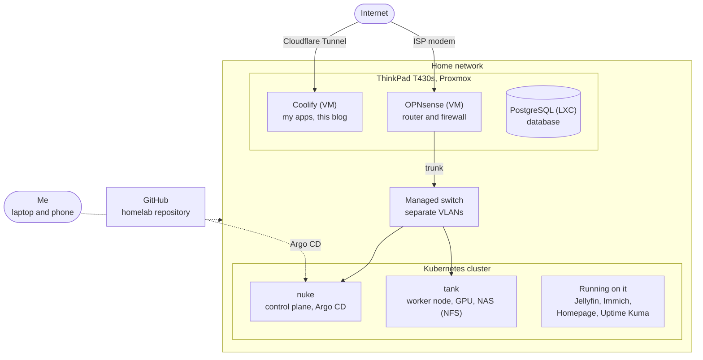

## Introduction

I started this homelab to learn what happens to an application after the code is written: where it runs, how it is reached, and how the machines under it are managed.

This post is the overview. It covers how the lab started, how it grew, what it looks like today and what I have learned so far. Each part will get its own post later, with the real configuration. The setup is in my public repository, [homelab](https://github.com/Megjafari/homelab).

## Where it started

It began with one old laptop, a ThinkPad T430s. I installed Linux on it to learn Linux. Then I heard about servers and installed Proxmox on the same machine.

After that I saw what I could host myself: my own streaming service, my own cloud storage and ad blocking for the whole network. That was when I got hooked.

## How it grew

After a while I heard about Kubernetes and networking. I wanted a challenge, so I started collecting older computers to build a cluster. At its biggest it had four nodes: a Dell OptiPlex as control plane, a Lenovo ThinkServer as NAS and worker, a GPU node and the T430s.

Then I rebuilt it around smaller machines to cut the power use. Later I removed a third small worker as well, because I did not need it and did not want to pay for the electricity.

## What it looks like today

| Machine | Role |
| --- | --- |
| ThinkPad T430s | Proxmox host. Runs OPNsense (router and firewall), Coolify and PostgreSQL |
| Intel NUC (`nuke`) | Kubernetes control plane |
| Self-built server (`tank`) | Kubernetes worker node with an RTX 3060 GPU. Also the NAS, with two 2 TB disks in RAID 1 shared over NFS |

Here is how the parts connect:

There is no rack. The machines hang on a metal wire panel on the wall.

## How it is managed

- **Kubernetes** is installed with kubeadm on Debian, with containerd. I chose kubeadm over something lighter like k3s because I wanted to learn the full setup.
- **Argo CD** syncs the manifests from the `homelab` repository, so the cluster follows what is in Git.
- **Ansible** configures the machines. The inventory and playbooks are in the same repository.
- **Storage:** `tank` shares a directory over NFS, and a provisioner creates volumes when pods ask for them. The default storage class means pods are not tied to one node.

## The network

OPNsense runs as a VM on the T430s. It is the router, firewall, DHCP and DNS. A managed switch splits the network into VLANs: one for the servers, one for my own devices, one for IoT devices and one for guests, plus a separate one for the connection from the ISP's modem.

I reach the lab from outside over Tailscale. The few things that are public go through a Cloudflare Tunnel, so I do not forward any ports on the router.

OPNsense first ran on a small Dell Wyse thin client. It had one network port and one RAM slot, and the network card started to time out. That caused outages that needed a restart with the power button. So I moved OPNsense to a VM on the T430s.

## What runs on it

- **Jellyfin** for streaming media
- **Immich** for my photo library
- **Homepage** as a dashboard for all the services
- **Uptime Kuma** to check that everything is up
- **Coolify** to deploy my own apps, including this blog. I wrote about that in [How I Deploy This Blog on My Homelab, and What Broke](/blog/how-i-deploy-this-blog-on-my-homelab-and-what-broke)

I will write about each of these in its own post.

## What I have learned so far

Three things I want to write about in detail:

1. **Set the hostname before a node joins the cluster.** I renamed a node after it had joined. Its certificate was made for the old name, so Kubernetes rejected it. I had to reset the node and join it again.
2. **Keep the configuration in Git.** When I moved the cluster to a new subnet, the certificates were tied to the old IP addresses and I rebuilt the cluster. Because the apps are defined in Git, Argo CD brought them back.
3. **A single network port is a poor base for a router.** That is the Dell Wyse story above.

## Paused: local AI

For a while I ran local language models on the GPU in `tank`. That is paused. I am busy with other things, and I want to learn it properly before I continue.

## What's next

These are plans, not finished work:

- Add monitoring and dashboards for the cluster.
- Update container images in `homelab` automatically.
- Write a post for each part of the lab, starting with the problems above.
